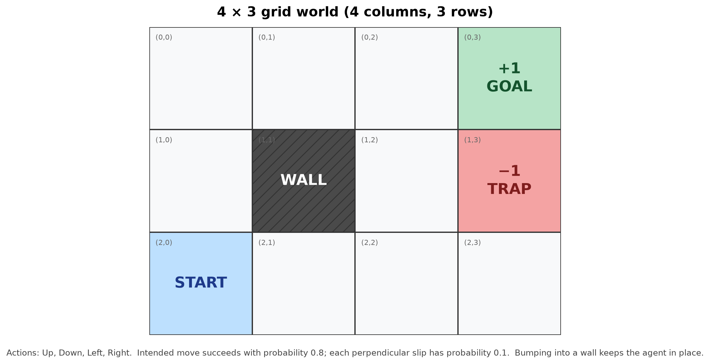
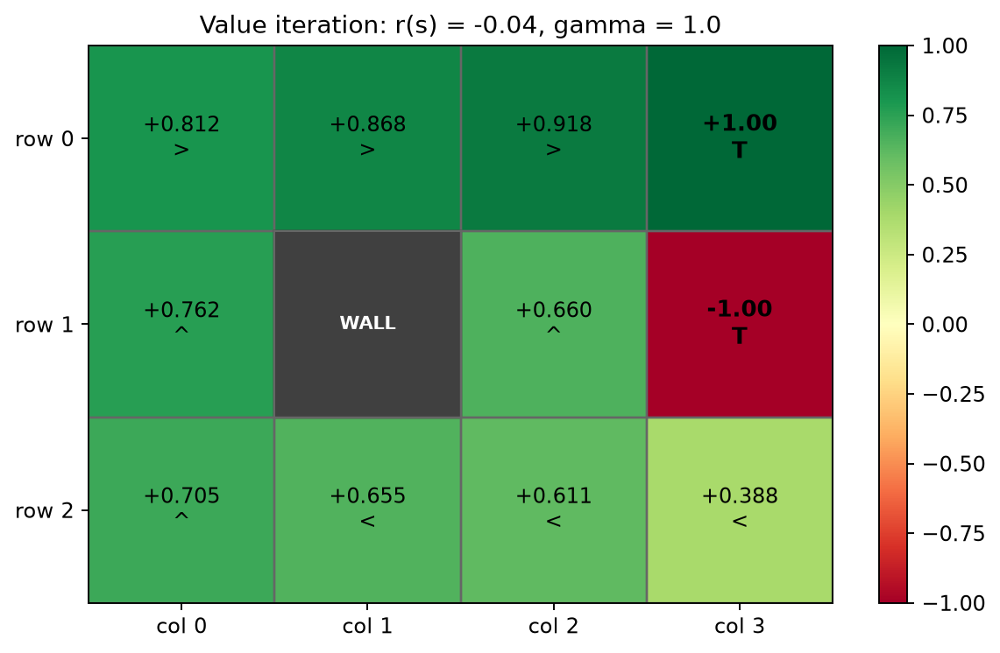
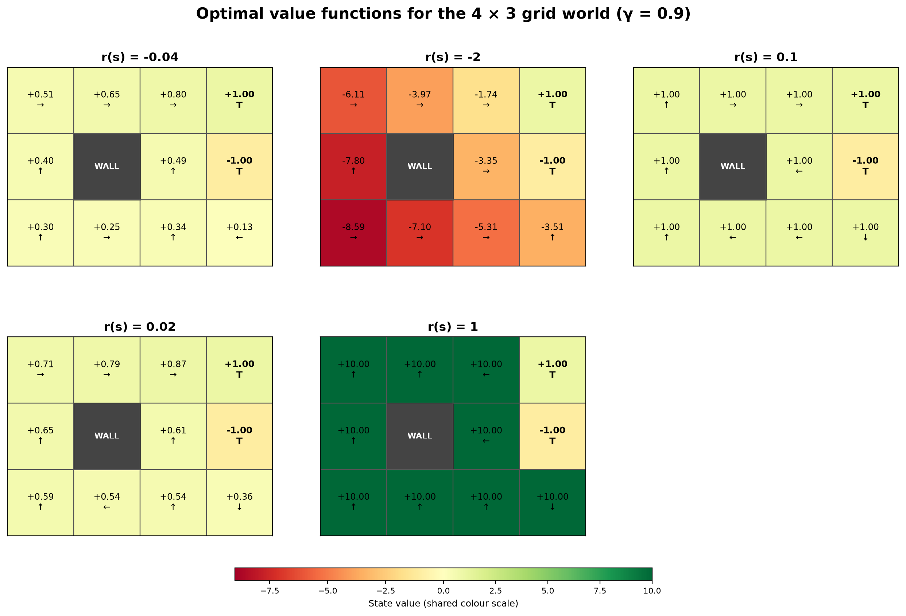
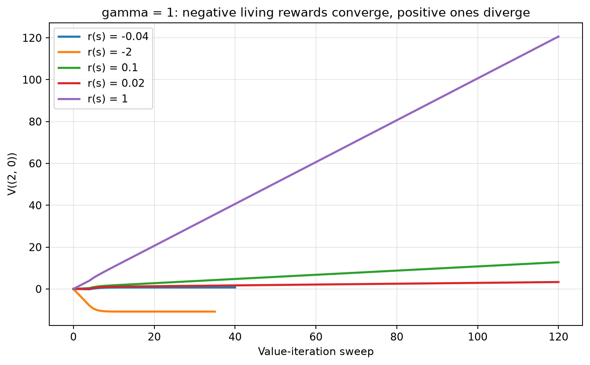
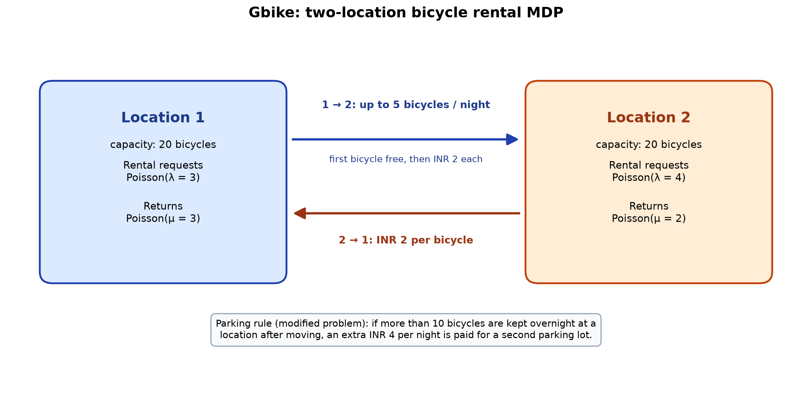
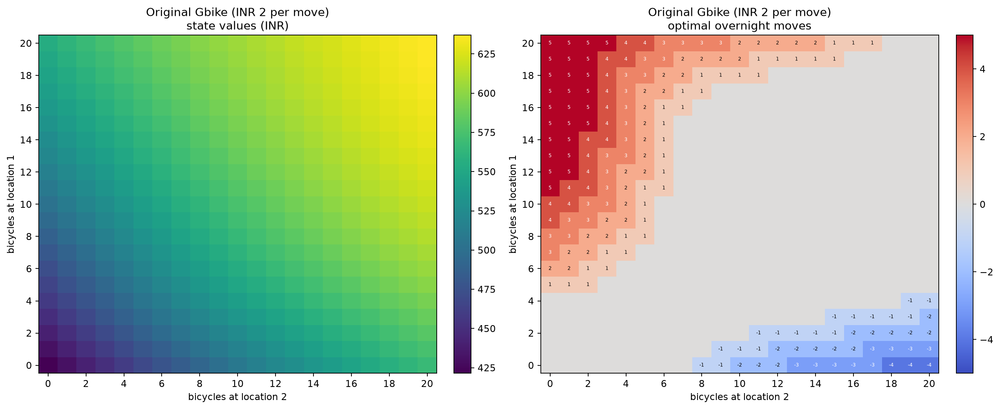
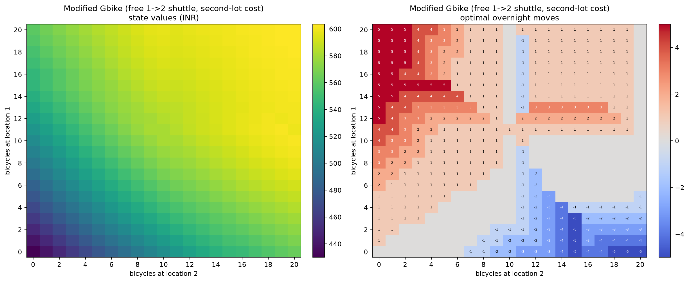
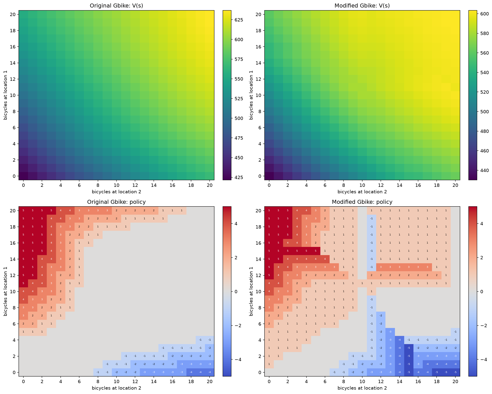
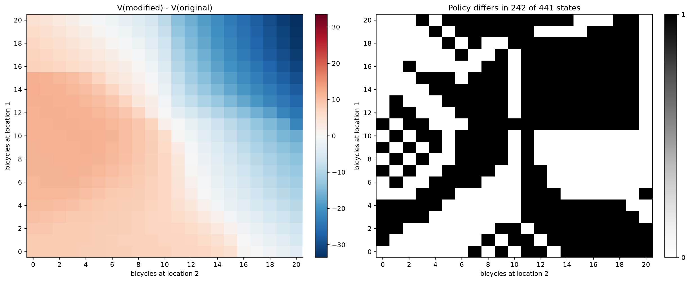

# Lab Assignment 10

## Markov Decision Processes and Dynamic Programming

*4×3 Grid World and Gbike Bicycle Rental*

**Course:** Artificial Intelligence  
**Lab:** 10 — Markov Decision Processes and Dynamic Programming  
**Name:** ______________________________  
**Roll Number:** ______________________________  
**Instructor:** ______________________________  
**Date:** 19 November 2026  

Implementation: Python 3.11, NumPy, SciPy, Matplotlib.

All numerical results in this report are generated directly by the accompanying code and saved in JSON/CSV form. The report can be regenerated with `python report/build_report.py`.

---

# 1. Objective

The objective of this lab is to understand sequential decision making in a stochastic environment and its connection with reinforcement learning. The work covers the Bellman equations, value iteration, policy iteration, and the formulation and solution of a continuing finite Markov decision process (MDP).

- Model the 4×3 grid world as a stochastic MDP and solve it with value iteration.
- Study how the living reward r(s) changes the optimal policy for r(s) = −0.04, −2, 0.1, 0.02 and 1.
- Formulate the Gbike bicycle-rental problem as a continuing finite MDP with Poisson demand and returns.
- Implement policy iteration and solve both the original Gbike problem and the modified problem with the free 1→2 shuttle and the second-parking-lot charge.

---

# 2. Part 1 — The 4×3 Grid World

## 2.1 MDP formulation

The environment is the standard 4-column × 3-row grid used by Russell and Norvig. Row 0 is the top row. The start state is (2,0); the terminal states are (0,3) with value +1 and (1,3) with value −1; the cell (1,1) is a wall. Figure 1 shows the layout.



*Figure 1: The 4×3 grid world. The start state is (2,0), the terminal states are +1 at (0,3) and −1 at (1,3), and (1,1) is a wall.*

**States.** The state space contains the 11 non-wall cells. The two terminal cells are absorbing: entering either one ends the episode.

**Actions.** In every non-terminal state the agent may choose Up, Down, Left or Right.

**Transition model.** The intended action succeeds with probability 0.8. With probability 0.1 the agent slips to each of the two directions at right angles to the intended direction. If a move (intended or slip) would leave the grid or enter the wall, the agent stays in its current cell. This wall-bumping rule is applied to every outcome, so the probabilities for an action always sum to 1. Table 1 gives representative examples.

*Table 1: Selected transition probabilities. Slips that hit a wall are merged into the stay outcome.*

| Current state | Action | Outcome | Probability |
|---|---|---|---|
| (2,0) | Up | (1,0) | 0.80 |
| (2,0) | Up | (2,0) — left slip hits wall | 0.10 |
| (2,0) | Up | (2,1) | 0.10 |
| (0,0) | Up | (0,0) — up and left slips hit walls | 0.90 |
| (0,0) | Up | (0,1) | 0.10 |
| (2,3) | Right | (2,3) — right slip hits wall | 0.90 |
| (2,3) | Right | (1,3) — terminal | 0.10 |

**Reward.** The living reward r(s) is received on every step out of a non-terminal state. The terminal values are fixed at +1 and −1. The implementation uses the convention

$$
V(s) = R(s) + γ · max_{a} Σ_{s′} P(s′ | s, a) · V(s′),
$$

with V(+1) = +1 and V(−1) = −1 held fixed. This is the same convention as Russell and Norvig and reproduces their published values for r(s) = −0.04 exactly. When a transition enters a terminal state, the agent pays the living reward of the current state and then receives the terminal value.

**Discount.** The canonical experiment uses γ = 1, as in the textbook. The reward sweep uses γ = 0.9 so that finite value functions exist for the positive living rewards; Section 2.4 explains why a discount is necessary.

## 2.2 Value iteration

Value iteration applies the Bellman optimality operator repeatedly. For every non-terminal state it computes

$$
V_{k+1}(s) = R(s) + γ · max_{a} Σ_{s′} P(s′ | s, a) · V_{k}(s′),
$$

leaving the terminal values fixed. The algorithm stops when the largest change between successive sweeps is below 10⁻¹⁰. The greedy policy is then extracted by choosing the action with the largest Q-value in every state.

```text
initialize V(s) = 0 for every non-terminal state
initialize V(+1) = +1 and V(-1) = -1
repeat
    delta = 0
    for every non-terminal state s
        V_new(s) = R(s) + gamma * max_a sum_s' P(s'|s,a) V(s')
        delta = max(delta, |V_new(s) - V(s)|)
    V = V_new
until delta < theta
policy(s) = argmax_a [ R(s) + gamma * sum_s' P(s'|s,a) V(s') ]
```

As an independent check, policy iteration is also implemented. It evaluates a policy exactly by solving the linear system (I − γP)V = R for that policy and then improves the policy greedily. For the canonical problem, policy iteration converges in 5 iterations, produces the same policy as value iteration, and the maximum absolute value difference is 7.4 × 10⁻¹¹.

## 2.3 Canonical result: r(s) = −0.04, γ = 1

Value iteration converges in 40 sweeps. The resulting values and greedy policy are shown in Table 2 and Figure 2. The values are the standard textbook values: 0.812, 0.868, 0.918, 0.762, 0.660, 0.705, 0.655, 0.611 and 0.388.

*Table 2: Canonical value function and policy for r(s) = −0.04, γ = 1.*

|  | col 0 | col 1 | col 2 | col 3 |
|---|---|---|---|---|
| row 0 | +0.812 → | +0.868 → | +0.918 → | +1.000 (T) |
| row 1 | +0.762 ↑ | WALL | +0.660 ↑ | -1.000 (T) |
| row 2 | +0.705 ↑ | +0.655 ← | +0.611 ← | +0.388 ← |



*Figure 2: Canonical value function and greedy policy for r(s) = −0.04 and γ = 1. The policy moves along the top row into the +1 terminal state and avoids the −1 state.*

The optimal policy sends the agent right along the top row into the +1 goal. The −1 terminal state is never entered. The negative living reward encourages the agent to finish the episode quickly, and the stochastic slips make the values smooth rather than deterministic.

## 2.4 Effect of the living reward

The assignment asks for the optimal value functions for r(s) = −2, 0.1, 0.02 and 1. With γ = 1, every positive living reward makes the MDP improper: the agent can avoid the terminal states forever and collect reward at every step, so the optimal value is unbounded. Value iteration therefore does not converge for r(s) > 0. This is not a numerical problem; it is the correct behaviour of an undiscounted MDP with positive rewards.

To obtain finite value functions for all requested rewards, the reward sweep uses γ = 0.9. This also matches the discount used in the Gbike problem. The γ = 1 behaviour is reported separately in Section 2.4.7. Table 3 summarises the sweep.

*Table 3: Reward sweep at γ = 0.9. V(start) is the value of the start state (2,0).*

| r(s) | γ | Sweeps | Converged | V(start) |
|---|---|---|---|---|
| -0.04 | 0.9 | 37 | Yes | +0.2965 |
| -2 | 0.9 | 36 | Yes | -8.5881 |
| 0.1 | 0.9 | 130 | Yes | +1.0000 |
| 0.02 | 0.9 | 121 | Yes | +0.5901 |
| 1 | 0.9 | 263 | Yes | +10.0000 |



*Figure 3: Optimal value functions for the five living rewards at γ = 0.9. The colour scale is shared across panels; arrows show the greedy action and T marks a terminal cell.*

### 2.4.1 r(s) = −0.04

With a mild negative living reward the agent still heads for the +1 terminal state, but the discount lowers the values relative to the γ = 1 case. The policy differs at (2,2), where the discounted problem prefers Up rather than Left. The start value is 0.296.

*Table 4: Value function and policy for r(s) = −0.04, γ = 0.9.*

|  | col 0 | col 1 | col 2 | col 3 |
|---|---|---|---|---|
| row 0 | +0.509 → | +0.650 → | +0.795 → | +1.000 (T) |
| row 1 | +0.399 ↑ | WALL | +0.486 ↑ | -1.000 (T) |
| row 2 | +0.296 ↑ | +0.254 → | +0.345 ↑ | +0.130 ← |

### 2.4.2 r(s) = −2

A large negative living reward makes every step expensive, so the agent takes a short route to a terminal state. The values are strongly negative (the start value is −8.588) and the policy in the bottom row moves right and then up into the −1 terminal. The negative reward dominates the +1/−1 terminal difference: reducing the number of steps is more important than avoiding the −1 goal.

*Table 5: Value function and policy for r(s) = −2, γ = 0.9.*

|  | col 0 | col 1 | col 2 | col 3 |
|---|---|---|---|---|
| row 0 | -6.107 → | -3.965 → | -1.738 → | +1.000 (T) |
| row 1 | -7.801 ↑ | WALL | -3.354 → | -1.000 (T) |
| row 2 | -8.588 → | -7.101 → | -5.310 → | -3.514 ↑ |

### 2.4.3 r(s) = 0.1

The agent avoids both terminal states and circulates forever. The discounted value of the infinite loop is 0.1 / (1 − 0.9) = 1.0, which is exactly the value shown in every non-terminal state. At γ = 1 this policy would be improper and the value would be infinite.

*Table 6: Value function and policy for r(s) = 0.1, γ = 0.9.*

|  | col 0 | col 1 | col 2 | col 3 |
|---|---|---|---|---|
| row 0 | +1.000 ↑ | +1.000 → | +1.000 → | +1.000 (T) |
| row 1 | +1.000 ↑ | WALL | +1.000 ← | -1.000 (T) |
| row 2 | +1.000 ↑ | +1.000 ← | +1.000 ← | +1.000 ↓ |

### 2.4.4 r(s) = 0.02

A small positive living reward still makes reaching the +1 goal worthwhile in most states, but the policy hesitates near the −1 terminal. The start value is 0.590. The agent prefers a longer but safer route to +1 rather than risking the −1 terminal.

*Table 7: Value function and policy for r(s) = 0.02, γ = 0.9.*

|  | col 0 | col 1 | col 2 | col 3 |
|---|---|---|---|---|
| row 0 | +0.713 → | +0.792 → | +0.874 → | +1.000 (T) |
| row 1 | +0.650 ↑ | WALL | +0.615 ↑ | -1.000 (T) |
| row 2 | +0.590 ↑ | +0.543 ← | +0.544 ↑ | +0.363 ↓ |

### 2.4.5 r(s) = 1

The agent avoids the terminal states completely and keeps collecting +1 forever. The discounted value is 1 / (1 − 0.9) = 10.0, which is the value shown in every non-terminal state. This is the clearest illustration that a positive living reward rewards survival rather than goal completion.

*Table 8: Value function and policy for r(s) = 1, γ = 0.9.*

|  | col 0 | col 1 | col 2 | col 3 |
|---|---|---|---|---|
| row 0 | +10.000 ↑ | +10.000 ↑ | +10.000 ← | +1.000 (T) |
| row 1 | +10.000 ↑ | WALL | +10.000 ← | -1.000 (T) |
| row 2 | +10.000 ↑ | +10.000 ↑ | +10.000 ↑ | +10.000 ↓ |

### 2.4.6 Summary of the policies

The sweep shows a clear progression. For negative rewards the agent terminates as quickly as possible: −2 produces the shortest route, while −0.04 still prefers the +1 goal. As the living reward becomes positive, the agent prolongs the episode, and at 0.1 or 1 it avoids the terminal states entirely. The discount factor controls how much future reward is worth: with γ = 0.9, the infinite stream of +0.1 is worth 1.0 and the infinite stream of +1 is worth 10.0.

### 2.4.7 Behaviour at γ = 1

Table 9 reports the γ = 1 behaviour after 300 sweeps. The two negative rewards converge, while all three positive rewards keep growing. Figure 4 plots V(start) against the sweep number. The growth is approximately linear: the r(s) = 1 curve gains about 1 per sweep and the r(s) = 0.1 curve gains about 0.1 per sweep. There is no finite optimal value function for these cases.

*Table 9: Behaviour at γ = 1 after 300 value-iteration sweeps. Positive living rewards do not converge.*

| r(s) | Converged | Sweeps used | V(start) after cap |
|---|---|---|---|
| -0.04 | Yes | 40 | +0.7053 |
| -2 | Yes | 35 | -10.8153 |
| 0.1 | No | 300 | +30.7641 |
| 0.02 | No | 300 | +6.9021 |
| 1 | No | 300 | +300.6112 |



*Figure 4: Value iteration at γ = 1. Negative living rewards converge; positive living rewards grow without bound because the agent can avoid the terminal states forever.*

**Takeaway.** The living reward determines how urgently the agent wants to leave the non-terminal part of the grid. Negative rewards encourage short episodes; positive rewards encourage long episodes. With no discount, “long” becomes infinite, so a discount is required for a well-posed finite value function.

---

# 3. Part 2 — Gbike Bicycle Rental

## 3.1 Problem description and MDP formulation

Gbike operates two bicycle-rental locations. Each day, customers arrive at each location and rent a bicycle if one is available, earning INR 10 per rental. Bicycles returned during the day become available the following day. Bicycles can be moved between the locations overnight at a cost of INR 2 per bicycle. Each location can hold at most 20 bicycles, and at most 5 bicycles can be moved in one night. The discount rate is γ = 0.9. Figure 5 shows the two-location system.



*Figure 5: The Gbike two-location MDP. Requests and returns are Poisson; the manager may move up to five bicycles overnight.*

**State.** The state is s = (c₁, c₂), where cᵢ is the number of bicycles at location i at the end of the day, after the day's rentals and returns. Each inventory is between 0 and 20, so there are 21 × 21 = 441 states.

**Action.** The action a ∈ {−5, −4, …, 0, …, 4, 5} is the net number of bicycles moved overnight. A positive action moves a bicycles from location 1 to location 2; a negative action moves −a bicycles in the opposite direction. An action is feasible only if

$$
0 ≤ c₁ − a ≤ 20,    0 ≤ c₂ + a ≤ 20,    |a| ≤ 5.
$$

**Dynamics.** One day proceeds as follows:

1. Move bicycles overnight: n₁ = c₁ − a and n₂ = c₂ + a.
2. Requests arrive at location i: Rᵢ ~ Poisson(λᵢ), with λ₁ = 3 and λ₂ = 4. The number served is min(Rᵢ, nᵢ), earning INR 10 each.
3. Returns arrive at location i: Tᵢ ~ Poisson(μᵢ), with μ₁ = 3 and μ₂ = 2. They are added to the inventory, capped at 20.
4. The resulting inventory is the next state s′.

*Table 10: Gbike MDP parameters.*

| Parameter | Value |
|---|---|
| Locations | 2 |
| State | (c₁, c₂), 0 ≤ c₁, c₂ ≤ 20 |
| Number of states | 441 |
| Actions | −5, −4, …, +5 (net bicycles moved 1 → 2) |
| Maximum move per night | 5 bicycles |
| Rental requests | Poisson(3) at location 1; Poisson(4) at location 2 |
| Returns | Poisson(3) at location 1; Poisson(2) at location 2 |
| Rental income | INR 10 per bicycle rented |
| Move cost | INR 2 per bicycle (first 1 → 2 bicycle free in the modified problem) |
| Parking cost | INR 4 per location per night if more than 10 bicycles are kept overnight (modified problem) |
| Discount | γ = 0.9 |

**Reward.** For a move a and post-move inventories n₁ and n₂, the expected immediate reward is

$$
R(s, a) = 10 · ( E[min(R₁, n₁)] + E[min(R₂, n₂)] ) − move(a) − park(n₁, n₂).
$$

The expected number of bicycles served at a location with c available bicycles is

$$
E[min(R, c)] = Σ_{k=0}^{c−1} k · P(R = k) + c · P(R ≥ c).
$$

**Original move cost.** In the original problem, move(a) = 2|a|, and there is no parking cost.

**Modified move cost.** The employee at location 1 takes one bicycle to location 2 for free each night. Every additional bicycle still costs INR 2, and every bicycle moved from location 2 to location 1 costs INR 2. Thus

$$
move(a) = 2|a| if a ≤ 0;    move(1) = 0;    move(a) = 2(a − 1) if a > 1.
$$

**Parking cost.** In the modified problem, if more than 10 bicycles are kept overnight at a location after moving, a fixed INR 4 is paid for a second parking lot at that location:

$$
park(n₁, n₂) = 4 · 1[n₁ > 10] + 4 · 1[n₂ > 10].
$$

**Transition probabilities.** Requests and returns are independent across the two locations, so the transition distribution factorises:

$$
P(s′ | s, a) = q_{1}(c_{1}′ | n_{1}) · q_{2}(c_{2}′ | n_{2}),
$$

where q(c′ | i, n) is the probability that location i, starting the day with n bicycles, ends the day with c′ bicycles after rentals and returns. Each q is computed by convolving the distribution of remaining bicycles after rentals with the Poisson return distribution, then capping at 20. This factorisation keeps policy iteration fast and exact.

**Objective.** The goal is to maximise the discounted expected total reward

$$
V^{π}(s) = E_{π}[ Σ_{t=0}^{∞} γ^{t} R(s_{t}, a_{t}) | s_{0} = s ],    γ = 0.9.
$$

## 3.2 Policy iteration

Policy iteration alternates exact policy evaluation and greedy policy improvement until the policy is stable. Because there are only 441 states, the evaluation step solves the linear system exactly; there is no iterative evaluation error.

**Policy evaluation.** For a policy π, solve

$$
(I − γP_{π}) V_{π} = R_{π}.
$$

**Policy improvement.** For every state, choose

$$
π′(s) = argmax_{a ∈ A(s)} [ R(s, a) + γ Σ_{s′} P(s′ | s, a) V_{π}(s′) ].
$$

Ties keep the current action, which prevents cycling between equally good moves. The algorithm starts from the “move nothing” policy and stops when no state changes.

```text
initialize policy pi(s) = 0 (move nothing) for every state
repeat
    evaluate pi exactly: solve (I - gamma P_pi) V = R_pi
    for every state s
        pi_new(s) = argmax_a [ R(s,a) + gamma sum_s' P(s'|s,a) V(s') ]
    if pi_new == pi: stop
    pi = pi_new
```

## 3.3 Original problem

Policy iteration converges in 5 iterations. The value of the central state is V(10,10) = 574.948 INR, V(0,0) = 421.414 INR and V(20,20) = 636.990 INR. Table 11 lists the iteration history and Figure 6 shows the value function and optimal policy.

*Table 11: Policy-iteration history for the original Gbike problem.*

| Iteration | States changed | V(10,10) (INR) |
|---|---|---|
| 1 | 318 | 550.7494 |
| 2 | 272 | 566.1004 |
| 3 | 79 | 574.8196 |
| 4 | 8 | 574.9480 |
| 5 | 0 | 574.9483 |



*Figure 6: Original Gbike problem. Left: state values. Right: optimal overnight moves (positive = 1 → 2, negative = 2 → 1).*

The optimal policy has the expected structure: when one location has many bicycles and the other has few, move up to five bicycles toward the low-inventory location. In the balanced middle of the state space, moving nothing is optimal. The original formulation is the standard Jack's car-rental problem from Sutton and Barto and serves as a sanity check for the implementation.

## 3.4 Modified problem

The modified problem changes two things. First, the employee at location 1 takes one bicycle to location 2 for free each night, so the first 1 → 2 move costs nothing. Second, if more than 10 bicycles are kept overnight at a location after moving, an extra INR 4 is paid for a second parking lot. Policy iteration converges in 4 iterations. The central value rises slightly to V(10,10) = 580.963 INR, while V(0,0) rises to 429.946 INR and V(20,20) falls to 603.491 INR.

*Table 12: Policy-iteration history for the modified Gbike problem.*

| Iteration | States changed | V(10,10) (INR) |
|---|---|---|
| 1 | 371 | 532.3363 |
| 2 | 265 | 563.9319 |
| 3 | 102 | 580.6287 |
| 4 | 0 | 580.9626 |



*Figure 7: Modified Gbike problem with the free 1→2 shuttle and the second-lot parking charge.*

The modified policy is visibly different from the original one. The free 1 → 2 shuttle creates a large region in which moving exactly one bicycle from location 1 to location 2 is optimal, even when both locations are below the parking threshold. The move is free and shifts a bicycle toward location 2, which has the higher request rate (4 versus 3).

The second-lot charge creates threshold effects around 10 bicycles. For example, at (13,11) the optimal action is −1: moving one bicycle back to location 1 costs INR 2 but avoids the INR 4 second-lot charge at location 2, so it is worth doing. At (13,12) the optimal action is +3: moving three bicycles to location 2 yields (10,15), empties the first lot below the threshold, and shifts bicycles toward the higher-demand location. The value of (20,20) drops by about 33.5 INR because both locations are over 10 bicycles and the manager cannot escape both second-lot charges quickly.

## 3.5 Comparison

Table 13 compares selected states. Across all 441 states, the optimal action changes in 242 states. The mean value change is −1.358 INR, the maximum gain is +12.057 INR, and the minimum change is −33.498 INR. The free shuttle is a pure benefit, while the second-lot charge is a pure cost; the net effect depends on the state.

*Table 13: Selected state values for the original and modified problems (INR).*

| State (c₁, c₂) | Original | Modified | Change |
|---|---|---|---|
| (10, 10) | 574.948 | 580.963 | +6.014 |
| (0, 0) | 421.414 | 429.946 | +8.532 |
| (20, 0) | 554.948 | 559.980 | +5.032 |
| (0, 20) | 567.769 | 563.861 | -3.908 |
| (20, 20) | 636.990 | 603.491 | -33.498 |
| (5, 15) | 577.226 | 573.861 | -3.365 |
| (15, 5) | 565.775 | 572.963 | +7.188 |
| (12, 8) | 571.686 | 578.963 | +7.276 |
| (8, 12) | 577.240 | 577.158 | -0.082 |



*Figure 8: Side-by-side comparison of the original and modified value functions and policies.*



*Figure 9: Left: change in state value after the modifications. Right: states where the optimal action changes (black = changed).*

The value-difference map is positive for moderate inventories, where the free shuttle helps, and strongly negative when both locations hold more than 10 bicycles, where the second-lot charges dominate. The policy-change map shows that the modifications affect a large portion of the state space, not just a narrow boundary region.

## 3.6 Validation

Several independent checks were run to make sure the formulation and implementation are correct. The factorised transition model was compared with a brute-force enumeration of requests and returns for a test state and action; the expected reward and expected next-state value matched to machine precision. Policy iteration was also compared with value iteration for both the original and modified MDPs.

*Table 14: Validation checks.*

| Check | Result |
|---|---|
| Grid transition probabilities sum to 1 | Passed for all 36 state-action pairs |
| Canonical grid values match Russell & Norvig | Passed (max error < 10⁻⁹) |
| Grid value iteration vs policy iteration | Passed (max |ΔV| = 7.4 × 10⁻¹¹; same policy) |
| Gbike next-state distributions sum to 1 | Passed for both locations |
| Factorised Gbike transition vs brute force | Passed (machine precision) |
| Original Gbike Bellman residual | 6.8 × 10⁻¹³ |
| Modified Gbike Bellman residual | 8.0 × 10⁻¹³ |
| Policies use only feasible actions | Passed for both problems |

All checks pass with `python validate.py`. The maximum difference between policy iteration and value iteration is 8.6 × 10⁻¹¹ for the Gbike MDPs.

**Note on gbike.zip.** No gbike.zip file was present in the repository or in the local Downloads folder, so there was no reference implementation to diff against. The implementation follows the formulation in the assignment and in Sutton and Barto, and the original problem is solved alongside the modified one so that the two formulations can be compared directly.

# 4. Conclusion

This lab demonstrated the complete workflow of dynamic programming for MDPs: formulate the state, action, transition and reward model; apply value iteration or policy iteration; and interpret the resulting value function and policy.

- For the 4×3 grid world, value iteration reproduced the textbook values for r(s) = −0.04 exactly and agreed with policy iteration to within 7.4 × 10⁻¹¹.
- The living reward controls how quickly the agent wants to terminate. Negative rewards produce short, goal-directed episodes; positive rewards produce long or non-terminating episodes.
- With γ = 1, positive living rewards make the MDP improper and the value function diverges. A discount such as γ = 0.9 is needed to obtain finite values.
- For Gbike, policy iteration converged in 5 iterations for the original problem and 4 for the modified problem. The free shuttle and the second-lot charge change the optimal policy in 242 of 441 states.
- The free 1 → 2 shuttle is valuable because location 2 has the higher request rate. The second-lot charge penalises keeping more than 10 bicycles at either location and creates threshold effects around 10.

The results also illustrate a practical reinforcement-learning lesson: the reward function and the discount factor are part of the problem specification, not implementation details. Small changes in either can produce qualitatively different optimal behaviour.

# 5. References

1. S. Russell and P. Norvig, *Artificial Intelligence: A Modern Approach*, 3rd edition, Chapters 16, 17 and 21.
2. R. S. Sutton and A. G. Barto, *Reinforcement Learning: An Introduction*, 2nd edition, Chapters 3 and 4 (the Jack's car-rental problem).
3. R. S. Sutton and A. G. Barto, *Reinforcement Learning: An Introduction*, 1st edition, Section 4.2 (policy iteration for Jack's car rental).

# Appendix A — Reproducing the results

The complete implementation is in the `lab10` folder. The main entry point runs both parts; the validation script checks the transition model, the textbook values and the Bellman residuals.

```text
cd lab10
python main.py                # run both parts
python main.py --part grid    # grid world only
python main.py --part gbike   # Gbike only
python validate.py            # correctness checks
```

The code writes all figures and numerical results to `outputs/`. The key files are `gridworld_results.json`, `gbike_results.json`, the value/policy CSV files, and the PNG figures included in this report.

*Table 15: Main output files.*

| File | Contents |
|---|---|
| gridworld_canonical.png | Canonical value function and policy |
| gridworld_reward_sweep.png | Value/policy panels for five rewards |
| gridworld_gamma1_divergence.png | Divergence of positive rewards at γ = 1 |
| gbike_original.png | Original Gbike values and policy |
| gbike_modified.png | Modified Gbike values and policy |
| gbike_comparison.png | Original vs modified comparison |
| gbike_differences.png | Value and policy difference maps |
| *.json / *.csv | Exact numerical results and policies |
